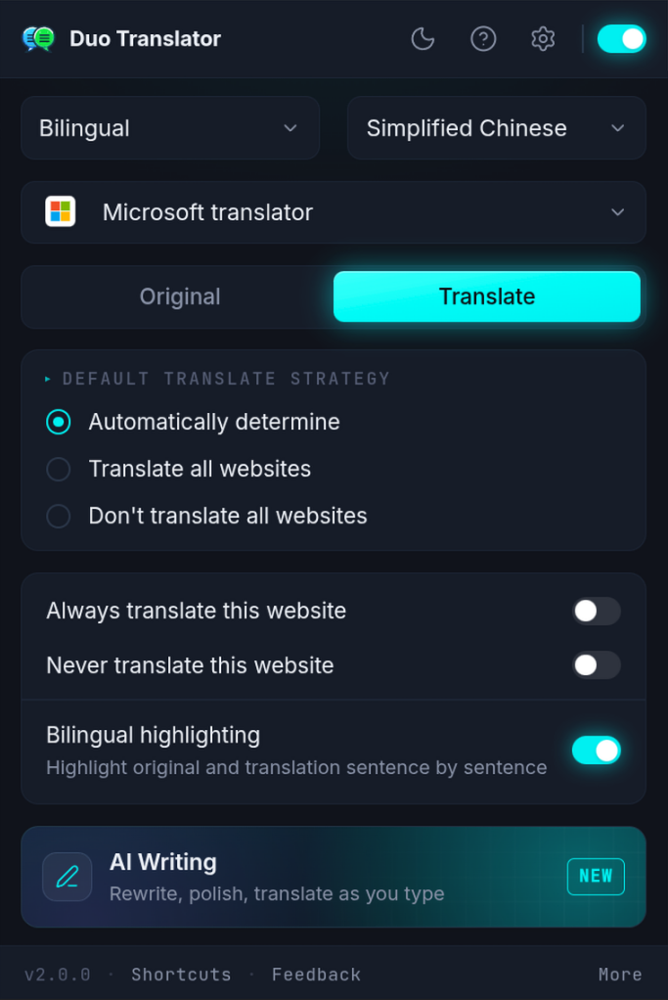
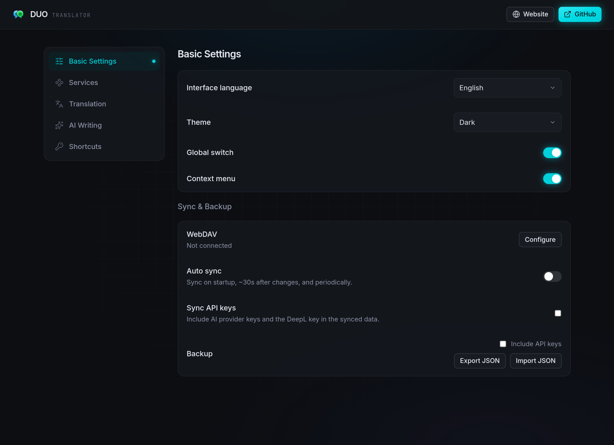
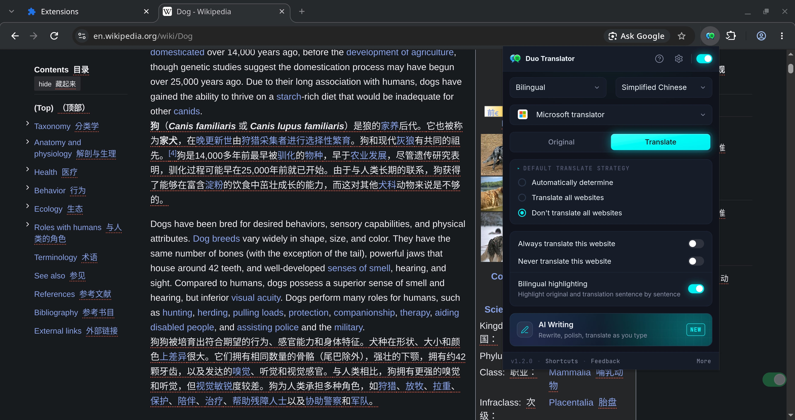
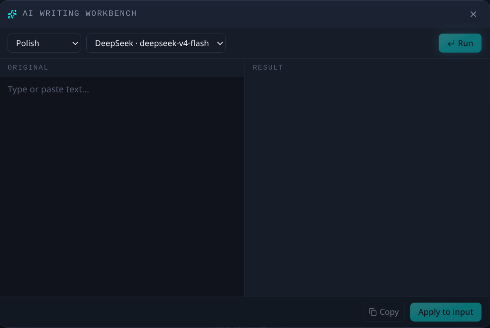

[README](README.md) | [中文文档](README_zh.md)
<h1 align="center">
  
  Duo Translator
</h1>

AI驱动的翻译和写作助手。支持网页翻译、划词翻译、写作增强等。

## 特性
- 翻译
  - 网页翻译
    - 双语翻译
    - 双语对照高亮（原文译文逐句对照高亮）
    - 样式设置
    - 网站翻译规则（按网站设置翻译区域、不翻译区域和自定义 CSS）
  - 划词翻译
    - 词典
    - 文本转语音 (TTS)
    - 翻译服务多选和精简界面（可选）
  - 输入框翻译
  - 段落翻译
- AI写作
  - 输入框中快速完成语法纠错、润色、翻译等操作
  - AI 写作工作台
- 视频字幕（YouTube 双语字幕）
  - 鼠标悬停时查询单词
  - 字幕下载
  - 字幕样式
  - AI 分句
- 接入多种翻译和AI服务
  - 翻译服务：微软、谷歌、Yandex、浏览器内置 AI（仅Chrome和Edge支持）、DeepL、[百度翻译（自备 APPID 和密钥）](docs/BAIDU.md)
  - AI：OpenAI、DeepSeek、Gemini、OpenRouter、OpenCode Go、Claude、Ollama、自定义
- 同步与备份
  - 同步方式：Google Drive、WebDAV
  - 自动同步（定时以及配置变更后触发）
  - 备份配置（导入导出 JSON文件）
- 快捷键
  - 浏览器快捷键
    - 翻译或恢复页面（Alt+S）
    - 划词翻译或输入框翻译（Alt+A）
    - 翻译或恢复鼠标悬停段落（Alt+Q）
    - 打开 AI 写作工作台（Alt+W）
  - 双击快捷键（双击 Ctrl/Alt）
    - 划词翻译
    - 输入框翻译
    - 翻译或恢复鼠标悬停段落

- 定制化
  - 功能快捷键（单击、长按或连击按键触发功能）
  - 划词翻译弹窗（UI 自定义）
  - 扩展弹窗（UI 自定义）

## 安装
添加到您的浏览器：

  
  
  
  

或者您可以通过zip文件手动安装。

Safari 用户请从 Mac App Store 安装 **Duo Translator for Safari**（要求 **macOS 上的 Safari 18.4 或更高版本**）。安装后打开 **Safari → 设置 → 扩展**，勾选启用，并把网站访问权限设为「在所有网站上允许」—— 扩展是在页面上原地改写内容，需要访问您浏览的网站。快捷键从 Safari 26 起才能修改，入口在 Safari → 设置 → 扩展。

## 社区

- [Discord](https://discord.gg/VSjWP752JV)
- [Telegram 中文](https://t.me/+v7Z9ssqrQLc3OGI5)
- [Telegram](https://t.me/+_097YKqnuGhlYmNh)

## 截图

# 开发

基于 [WXT](https://wxt.dev/) + React 构建，包管理器使用 [pnpm](https://pnpm.io/)。

1. 安装依赖：`pnpm i`
2. 启动开发构建（支持热重载）：`pnpm dev`（Firefox：`pnpm dev:firefox`）
3. 打开 `chrome://extensions/`，开启开发者模式，从 `.output/chrome-mv3-dev` 文件夹加载已解压的扩展程序

其他命令：

- `pnpm build` — 生产构建，输出到 `.output/chrome-mv3`（Firefox：`pnpm build:firefox`，Edge：`pnpm build:edge`）
- `pnpm zip` — 打包扩展用于商店上传
- `pnpm test` — 单元测试（Vitest）
- `pnpm e2e:build && pnpm e2e` — 端到端测试（Playwright）

友情链接

感谢 [LINUX DO](https://linux.do/) 社区提供的帮助与支持。
